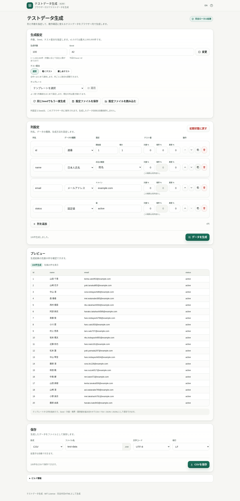

# Test Data Generator

[](https://github.com/ttomohisa/htmlapps-test-data-generator/actions/workflows/deploy-pages.yml)
[](LICENSE)
[](https://ttomohisa.github.io/htmlapps-test-data-generator/)

[日本語版 README](README.ja.md)

A local-first browser tool for generating reproducible test data. Along with normal mock data, it can mix missing, boundary, and invalid values for software testing. Generation and file creation stay inside the browser.

## Live app

### [Open Test Data Generator on GitHub Pages](https://ttomohisa.github.io/htmlapps-test-data-generator/)

[](https://ttomohisa.github.io/htmlapps-test-data-generator/)

## Features

- Set a row count from 1 to 1,000,000, with a 10,000,000-cell safety limit across rows × columns.
- Exports are capped at **128 MiB per UTF-8 file** to reduce browser memory exhaustion; if the limit is reached, reduce the row count, columns, or value lengths and retry.
- Numeric settings reject out-of-safe-range sequence values, fractional ranges with no representable decimal value, and invalid calendar dates in imported settings.
- Run large generation in a Web Worker so the main UI remains responsive.
- Show progress and allow cancellation for both generation and file creation.
- Validate all rows in the worker while retaining only the first 20 rows in the page, then regenerate from the same Seed and settings when exporting.
- Serialize large exports in chunks instead of retaining every row object on the main thread.
- Apply **Normal / Light test / Stricter test** presets across all columns.
- Configure **Missing % / Boundary % / Invalid %** for each column.
- Export missing values as `null` in JSON / JSONL and empty cells in CSV / TSV.
- Generate boundary values for seven range-oriented types, including configured endpoints and relevant calendar edges.
- Generate type-appropriate invalid values for all 23 data types.
- Show Missing / Boundary / Invalid badges in preview without adding helper columns to exported data.
- Enter a Seed to reproduce the same generated rows from the same settings and row count.
- Leave Seed blank to create one automatically, or use **Change Seed** for a new value.
- Generate again with the previous Seed to reproduce a dataset after comparing results.
- Save / load `test-data-schema.json` containing row count, Seed, and column settings only.
- Start from User, Customer, Employee, Product, Order, Inquiry, or Access log templates.
- Confirm before a template replaces existing columns and inherit the selected Normal / Light / Stricter test mix.
- Add, duplicate, delete with Undo, and reorder columns.
- Generate the 14 existing basic types: sequence, integer, decimal, boolean, UUID, random string, choice, fixed value, date, date/time, money, percent, URL, and IPv4.
- Generate Japanese name, kana name, email, phone, postal code, prefecture, city/ward, Japanese-style address, and company name values.
- Choose full / surname / given name and Hiragana / Katakana output where applicable.
- Configure email domains and mobile / landline phone generation.
- Group Basic and Japanese data separately in the type selector.
- Validate type settings before generation and highlight invalid columns.
- Preview the first 20 rows without rendering the full dataset into the DOM.
- Copy those preview rows as JSON with the first-N-of-M scope shown, up to 1 MiB without truncation. Clipboard restrictions offer a selectable manual-copy dialog.
- Preserve literal column names such as `__proto__` in preview and all exports.
- Save the generated dataset as CSV, TSV, JSON, JSONL, or Parquet.
- Choose UTF-8, UTF-8 BOM, Windows-31J / Shift_JIS, or UTF-16 LE (with BOM) for CSV / TSV and LF / CRLF line endings.
- Set the output filename while the extension follows the selected format automatically.
- Preserve commas, tabs, double quotes, and line breaks correctly in delimited exports.
- Persist column settings locally when browser storage is available.
- Japanese / English UI with responsive desktop and smartphone layouts.
- Fully local processing with runtime network connections blocked by CSP.
- Readable single-HTML build plus optional gzip self-extracting single-HTML build.

To generate matching Japanese names and readings, add a Japanese name column and choose it as the name source in a kana column. You can reorder the two columns and select hiragana or katakana. Other Japanese fields, including email, are generated independently.

## Usage

1. Enter the number of rows and an optional Seed.
2. Choose a test mix preset if needed.
3. Optionally apply a built-in template. Check its row and column counts, then choose **Generate with these settings** to go straight to the preview.
4. Adjust column names, data types, and test-value rates, then add, duplicate, delete, or reorder columns as needed.
5. Select **Generate data**. A blank Seed is created automatically. If a setting is invalid, focus moves to the field to correct. For a test mix over 100%, the message shows how many percentage points to remove.
6. Review the first 20 rows. Select a Missing, Boundary, or Invalid count to inspect up to five examples of that kind from the entire dataset, with row numbers, column names, and values. **Copy preview as JSON** copies only these rows, including numbers and missing-value `null`s. Save a JSON file for all rows or previews larger than 1 MiB.
7. Choose an output format and filename, then save the generated file.
8. Use **Save settings file** if you want to keep the row count, Seed, and column schema for later.

Use the header Help button for instructions and notes. Help stays near the top of the screen, scrolls its text independently, and restores your place when closed. You can also close it with Escape or by clicking outside; Tab reaches the reading area for keyboard scrolling.

Numeric settings are required; enter `0` explicitly where allowed. Editing settings or Seed cancels pending work and requires regeneration before saving. Keyboard focus stays with a moved column or changed type; Delete moves to a neighboring name and Undo returns to the restored name.

Known filename extensions are normalized to the selected format (`sample.csv` becomes `sample.json` when saving JSON). Blank names use `test-data`.

## Formats and character encodings

Parquet (`.parquet`) is available alongside CSV, TSV, JSON and JSONL. Parquet preserves nullable typed columns: normally INT64 for integral fields, DOUBLE for decimals/money, BOOLEAN for plain booleans, and UTF-8 strings for text and date/time representations. When malformed test examples would create mixed value types in one column, a representable string or numeric type is used instead. Parquet output is uncompressed.

For CSV and TSV only, choose UTF-8 (default), UTF-8 with BOM, Windows-31J / Shift_JIS, or UTF-16 LE with BOM. Characters that cannot be encoded in Shift_JIS fail the export without silent replacement. JSON and JSONL remain UTF-8; Parquet stores UTF-8 strings. Line endings are not configurable for Parquet.

The existing limits of 1,000,000 rows, 10,000,000 cells and 128 MiB per output file remain, as do cancellable generation and deterministic Seed output.

## Privacy

Generation runs entirely in the browser. The app does not upload column settings or generated rows, and it does not use analytics or telemetry. Japanese dictionaries are embedded in the HTML. Column settings and Seed may be saved in local browser storage so they can be restored after reload. Generated rows are not stored automatically. Settings files contain configuration only and are created locally.

Copy writes only after you select the Copy action. The system clipboard may be accessible to other apps or device clipboard syncing; the app does not upload the copied JSON.

The default Content Security Policy includes `connect-src 'none'`.

## Release

After a PR is merged into `main`, GitHub Actions builds and verifies both standalone HTML variants. If the version in `app.config.json` has no tag yet (for example `1.0.3`), it creates `v1.0.3` and a GitHub Release containing the readable and self-extracting HTML files. An existing tag or Release is not duplicated; bump the version before the next release.

On phones, the informational "Fully local processing" hero label is hidden to reduce clutter. The no-runtime-network behavior is unchanged.

## Development

The repository follows the `htmlapps-template` single-HTML application contract. Read [AGENTS.md](AGENTS.md) and [APP_SPEC.md](APP_SPEC.md) before changing the application.

The editable application source is:

```text
src/index.template.html
```

Do not edit generated files in `dist/` directly.

## Build

On Windows 10/11:

```bat
build-standalone.bat
```

Generated output:

```text
dist/
├─ index.html
├─ index.self-extract.html
├─ dependency-manifest.json
├─ build-size-report.json
├─ self-extract-manifest.json
└─ .nojekyll
```

To open the already-built readable version directly on Windows:

```bat
start-local.bat
```

## Browser support

Current stable desktop and mobile Chromium, Firefox, and Safari are the target. Direct `file://` opening is part of the template contract.

## License

[MIT License](LICENSE)

Application regression checks require Node.js 22 or newer (CI uses Node.js 24). The repository check tests source and all generated variants; the normal build also refreshes `test-data-generator.html`.

### Help layout regression

The normal repository check includes the dependency-free Help lifecycle and canonical-icon assertions in all release variants. For optional rendering checks, install development-only Python Playwright, then run `CHROMIUM_PATH=/path/to/chromium python scripts/test-data-help-browser.py` after building (use `--source` before building). The isolated loopback fixture checks desktop/phone geometry, page-scroll locking and restoration, keyboard reading, repeated dismissal, resizing, and unexpected runtime HTTP requests. This test dependency is not shipped with the application.
